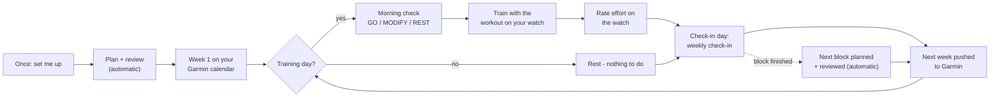

# garmin-coach

An adaptive training coach for Garmin watch owners that runs inside your own
AI assistant (Claude Code, OpenAI Codex, or opencode with a local model) on
your own subscription or hardware. It
creates your workouts and syncs them to your Garmin watch automatically.

- **Onboarding**: reads your Garmin history first (activities, lifts, VO2max,
  HRV/sleep baselines), then asks about goals, injuries, schedule, equipment
  and food, one topic at a time.
- **Long-term plan**: measurable goals, a milestone ladder, and training
  blocks (base, build, peak, test, deload) detailed only when they're close.
- **Daily check**: last night's recovery vs *your own* 60-day baseline, factor
  by factor, then GO / MODIFY / REST for today's session.
- **Weekly check-in**: adherence, performance, recovery and progress
  toward goals, plan changes when the evidence supports them, and next week
  pushed to your Garmin calendar.
- **Specialist review**: every block is checked by programming, recovery,
  injury-risk, nutrition, data and goal-specific roles before it starts.
- **Goal modules**: strength (1RM), hypertrophy, endurance (VO2max, race
  times), calisthenics skills, body composition, general fitness.
- **Any environment**: commercial gym, home gym, minimal or bodyweight, with
  substitutions and load rounding to the plates or dumbbells you own.

Your data stays in a folder on your computer (`~/coach`). The plugin holds
no athlete data.

> Not medical advice. The Garmin connection uses the unofficial Garmin Connect
> API ([Taxuspt/garmin_mcp](https://github.com/Taxuspt/garmin_mcp)); it can
> break when Garmin changes things.

## What you need

- A Garmin watch synced to a **Garmin Connect** account
- A **Claude Pro or Max** plan (for Claude Code), a ChatGPT plan that
  includes **Codex**, *or* [opencode](https://opencode.ai) with any provider,
  including a local model on your own GPU (see [Local models](#local-models-opencode))
- A Mac, Windows 10/11 or Linux computer

Everything else (git, uv, Python, Claude Code) is installed by the setup command.

## Quick start: one command

**1. Open a terminal**

| Mac | Windows | Linux |
|---|---|---|
| Press `Cmd + Space`, type **Terminal**, press Enter | Press the Windows key, type **PowerShell**, press Enter (not "as administrator") | Open your Terminal app |

**2. Paste the command for your computer and press Enter**

Mac / Linux:
```sh
curl -fsSL https://raw.githubusercontent.com/fedetic/garmin-coach-plugin/main/scripts/setup.sh | bash
```

Windows (PowerShell):
```powershell
irm https://raw.githubusercontent.com/fedetic/garmin-coach-plugin/main/scripts/setup.ps1 | iex
```

<details>
<summary>Using Codex instead of Claude Code?</summary>

Install [Codex](https://developers.openai.com/codex/cli) first, then:

```sh
# Mac / Linux
curl -fsSL https://raw.githubusercontent.com/fedetic/garmin-coach-plugin/main/scripts/setup.sh | bash -s -- --codex
```
```powershell
# Windows
$env:COACH_TOOL="codex"; irm https://raw.githubusercontent.com/fedetic/garmin-coach-plugin/main/scripts/setup.ps1 | iex
```
</details>

<details>
<summary>Using opencode (e.g. with a local model)?</summary>

Install [opencode](https://opencode.ai) first, then:

```sh
# Mac / Linux
curl -fsSL https://raw.githubusercontent.com/fedetic/garmin-coach-plugin/main/scripts/setup.sh | bash -s -- --opencode
```
```powershell
# Windows
$env:COACH_TOOL="opencode"; irm https://raw.githubusercontent.com/fedetic/garmin-coach-plugin/main/scripts/setup.ps1 | iex
```
In opencode, press **Tab** to switch to the `coach` agent. For a local model,
read [Local models](#local-models-opencode) first.
</details>

The script walks through 6 steps and skips anything that's already done, so
it's safe to run again if something fails halfway:

1. **git**: needed to download the Garmin connector (Windows: installed via winget; Mac: the developer-tools popup)
2. **uv**: runs the coach and Garmin servers, and installs Python by itself
3. **Claude Code** (or checks that Codex or opencode is there)
4. **The garmin-coach plugin**
5. **Garmin Connect login**: your email, password and MFA code if you use one. Only a login token is saved, in `~/.garminconnect` on your computer, and it lasts about 6 months.
6. **Your coaching folder**: `~/coach`

**3. Start coaching**

```sh
cd ~/coach
claude          # or: codex, opencode
```

The first time, Claude Code asks you to log in in your browser. Then type:

```
set me up as a new athlete
```

## Step-by-step setup (if you prefer, or if the script stops)

Run these in the same terminal. After each install step, **close and reopen
the terminal** if the next command says "not found" or "not recognized".

<details>
<summary><b>1. git</b></summary>

| Mac | Windows | Linux (Ubuntu/Debian) |
|---|---|---|
| `xcode-select --install` | `winget install --id Git.Git -e` | `sudo apt install git` |

Check: `git --version`
</details>

<details>
<summary><b>2. uv</b></summary>

| Mac / Linux | Windows |
|---|---|
| `curl -LsSf https://astral.sh/uv/install.sh \| sh` | `powershell -ExecutionPolicy ByPass -c "irm https://astral.sh/uv/install.ps1 \| iex"` |

Check: `uv --version`
</details>

<details>
<summary><b>3. Claude Code</b> (skip if you use Codex)</summary>

| Mac / Linux | Windows |
|---|---|
| `curl -fsSL https://claude.ai/install.sh \| bash` | `irm https://claude.ai/install.ps1 \| iex` |

Check: `claude --version`. More options: [Claude Code setup docs](https://code.claude.com/docs/en/setup).
</details>

<details>
<summary><b>4. The plugin</b></summary>

Claude Code (all systems):
```sh
claude plugin marketplace add fedetic/garmin-coach-plugin
claude plugin install garmin-coach@garmin-coach
```

Codex:
```sh
# Mac / Linux
git clone https://github.com/fedetic/garmin-coach-plugin.git ~/.garmin-coach/plugin
uv run --project ~/.garmin-coach/plugin/server coach-codex install
```
```powershell
# Windows
git clone https://github.com/fedetic/garmin-coach-plugin.git $HOME\.garmin-coach\plugin
uv run --project $HOME\.garmin-coach\plugin\server coach-codex install
```
This links the same skills into `~/.agents/skills` and registers the same
two servers in `~/.codex/config.toml`. Remove with `... coach-codex uninstall`.

opencode: the same two commands with `coach-opencode install` (add
`--with-garmin` to also turn on the full Garmin server). It links the skills
into `~/.agents/skills`, adds the servers to `~/.config/opencode/opencode.json`
(merged, never overwritten), and writes a `coach` agent and a small session
plugin into `~/.config/opencode/`. Remove with `... coach-opencode uninstall`.
</details>

<details>
<summary><b>5. Garmin login</b></summary>

All systems:
```sh
uvx --python 3.12 --from git+https://github.com/Taxuspt/garmin_mcp garmin-mcp-auth
```
Run it again whenever the coach says the Garmin login has expired.
</details>

<details>
<summary><b>6. Coaching folder</b></summary>

| Mac / Linux | Windows |
|---|---|
| `mkdir ~/coach && cd ~/coach` | `mkdir ~\coach; cd ~\coach` |
</details>

## Use

Always start the coach **from your coaching folder**:

```sh
cd ~/coach
claude          # or: codex, opencode
```

Just talk to it in plain language. These are the main things it does (you
can also call them directly):

| Say | What happens | Claude Code | Codex |
|---|---|---|---|
| "set me up" / "my goals changed" | onboarding, or updating goals/equipment/schedule | `/garmin-coach:coach-setup` | `$coach-setup` |
| "morning check" | today's GO / MODIFY / REST | `/garmin-coach:coach-daily` | `$coach-daily` |
| "weekly check-in" | weekly report + next week on Garmin | `/garmin-coach:coach-weekly` | `$coach-weekly` |
| "plan my next block" | build or revise the plan | `/garmin-coach:coach-plan` | `$coach-plan` |
| "review this block" | specialist sign-off | `/garmin-coach:coach-review` | `$coach-review` |
| "push this week to Garmin" | create and schedule workouts | `/garmin-coach:coach-garmin-sync` | `$coach-garmin-sync` |

In opencode, switch to the `coach` agent (Tab) and just say it; the agent
loads the right skill.

### A typical week



| When | You do | The coach does |
|---|---|---|
| **Once** | "set me up as a new athlete" (~20-30 min) | reads your Garmin history, asks what it can't see, builds the plan, reviews it, puts week 1 on your Garmin calendar |
| **Morning of a training day** (~1 min) | "morning check" | compares last night's sleep/HRV/resting HR/Body Battery to *your* normal, says GO / MODIFY / REST, and updates today's workout on Garmin if it changes |
| **During training** | start today's workout on the watch (it's on your Garmin calendar) and follow the steps | nothing. The watch records sets, reps and weight |
| **Right after training** | rate the effort on your watch or in Garmin Connect (perceived effort, 1-10), and fix any set the watch mislabeled | uses it at the next check-in. An effort that's never rated can't guide the plan |
| **Rest days** | nothing (a morning check is optional) | nothing |
| **Check-in day** (you pick it, e.g. Sunday, ~5-10 min) | "weekly check-in", then answer a few questions (missed sessions, pain, sleep) | weekly report, adjusts the plan only if the data supports it, **pushes next week's workouts to Garmin** |
| **End of a block** (every ~3-8 weeks) | nothing extra, it happens inside the weekly check-in | plans the next block, runs the specialist review, pushes week 1 |

### When to ask for what

- **New workouts on Garmin?** You normally never ask. The weekly check-in
  schedules next week, and a morning check updates today if needed. Ask
  ("push this week to Garmin", "move Thursday's session to Friday") only when
  your schedule changes or something is missing on the watch.
- **A review?** It runs automatically before every new block. Ask yourself
  only after you've changed the plan by hand ("I want to add a run on
  Wednesdays") or if you'd like a second opinion on a big change. There's no
  need to request one weekly.
- **Something changed?** Just say it at any time: "my knee hurts on squats",
  "I'm travelling next week, hotel gym only", "I can only train 3 days now",
  "I signed up for a 10k in March". The coach adjusts the plan and the Garmin
  calendar.
- **Missed a check-in?** No problem. The next one covers everything since the
  last one. The coach also reminds you when a check-in is due.

### Using more than one computer

Make `~/coach` a **private** git repository and set `git_sync: true` in
`~/coach/coach.yml`. The coach pulls at the start of each session and saves
and pushes at the end. Don't run sessions on two computers at the same time.

## Local models (opencode)

The coach is built so a model that fits on one consumer GPU can run it. The
coach server does the Garmin fetching, parsing, math, workout building and
verification, and drafts the daily GO / MODIFY / REST and the weekly status.
The model reads compact summaries (a daily check is one tool call returning
about 500 tokens) and spends its effort on judgment and talking to you.

**What to expect on 16 GB of VRAM**

- Use a model with solid tool calling at 4-bit, e.g. a Qwen3 14B-class or
  gpt-oss-20b-class model, and leave room for a 32k context.
- Daily checks, weekly check-ins and pushing workouts are the flows small
  models handle well. Writing a whole new training block is the hardest
  task: `validate_block` catches mechanical mistakes and the model must fix
  them, but review the plan yourself, or do planning with a bigger model.

**Context window (the most common problem)**

Ollama's default context is 4k on GPUs under 24 GB, and it silently cuts
longer prompts off, which looks like the model ignoring instructions or
failing tool calls. Give it at least 32k:

```sh
OLLAMA_CONTEXT_LENGTH=32768 ollama serve
```

If Ollama runs as a system service (the Linux installer sets one up),
exporting the variable in your shell does nothing: add
`Environment="OLLAMA_CONTEXT_LENGTH=32768"` with `sudo systemctl edit ollama`,
then `sudo systemctl restart ollama`.

Then tell opencode about the model (`~/.config/opencode/opencode.json`,
next to the `mcp` block the installer added):

```json
"provider": {
  "ollama": {
    "npm": "@ai-sdk/openai-compatible",
    "options": { "baseURL": "http://localhost:11434/v1" },
    "models": { "qwen3:14b": { "name": "Qwen3 14B", "limit": { "context": 32768, "output": 8192 } } }
  }
}
```

**Garmin server off by default**

The installer registers the full Garmin server but leaves it disabled: its
~150 tool definitions would take most of a small model's context. The coach
server covers setup, daily, weekly, workouts, HR zones, nutrition and VO2max
by itself. Turn the Garmin server on (`"enabled": true` under `mcp.garmin`)
only with a large context or a hosted model.

## Updating and removing

| | Claude Code | Codex | opencode |
|---|---|---|---|
| Update | `claude plugin update garmin-coach@garmin-coach` (or re-run the setup command) | re-run the setup command, or `git -C ~/.garmin-coach/plugin pull` | same as Codex |
| Remove | `claude plugin uninstall garmin-coach@garmin-coach` | `uv run --project ~/.garmin-coach/plugin/server coach-codex uninstall` | `... coach-opencode uninstall` |

Removing the plugin never touches your `~/coach` folder.

## How it's built (and why it ports 1:1)

```
garmin-coach-plugin/
├── skills/                  # Agent Skills standard (SKILL.md), read by Claude Code, Codex and opencode
│   ├── coach-core/          # operating manual + references/ + goals/ (loaded by every other skill)
│   ├── coach-setup/ coach-daily/ coach-weekly/ coach-plan/ coach-review/ coach-garmin-sync/
├── server/                  # coach MCP server (Python): the deterministic half
│   └── coach_mcp/           #   server.py (tools), ops.py + garmin_live.py (one-call Garmin tools),
│                            #   session.py (hooks), codex.py / opencode.py (installers)
├── hooks/hooks.json         # session start/end: status line + optional git sync
├── scripts/setup.sh, setup.ps1   # one-command setup
├── .mcp.json                # MCP servers (coach + garmin) for Claude Code
├── .claude-plugin/          # Claude Code manifest + marketplace
├── .codex-plugin/           # Codex manifest
└── .agents/plugins/         # Codex marketplace
```

Portability rules:
- Only the parts every tool supports go in the core: skills, MCP servers and
  session hooks (opencode runs them through a small plugin instead of shell hooks). No Claude-only subagents or slash-command files; the specialist
  roles are reasoning perspectives in a skill reference.
- Skills reference each other by relative path (`../coach-core/...`).
- Everything runs through `uv` and Python: no bash or `python3` dependency,
  so it works the same on Windows.
- Anything that should give the same answer every time is an MCP tool, not a
  prompt: readiness baselines, e1RM/%1RM, load rounding, Garmin workout
  payloads, validated logging. This makes the server reusable as the backend
  of a future app.

Coach MCP tools: `workspace_status` · `init_workspace` · `query` · `log` ·
`update_record` · `upsert_training_block` · `record_metrics` ·
`readiness_report` · `estimate_1rm` · `prescribe_load` · `round_load` ·
`find_garmin_exercise` · `build_strength_workout` · `register_garmin_workout`
· `import_activity` · `training_summary` · `goal_progress`

Workspace layout:

```
~/coach/
├── coach.yml                # settings (units, check-in day, git_sync)
├── AGENTS.md, CLAUDE.md     # always-loaded pointer + your standing rules
├── athlete/                 # profile.md, equipment.yml, schedule.yml, nutrition.md
├── plan/                    # roadmap.yml, blocks/block-NN-*.yml
├── data/coach.db            # sqlite (coach.sql text dump is what git syncs)
└── journal/context.md       # session handover
```

## Development

```sh
git clone https://github.com/fedetic/garmin-coach-plugin.git && cd garmin-coach-plugin
cd server && uv run --group dev pytest -q && cd ..
claude plugin validate .
claude --plugin-dir .        # run Claude Code with your local copy
```
